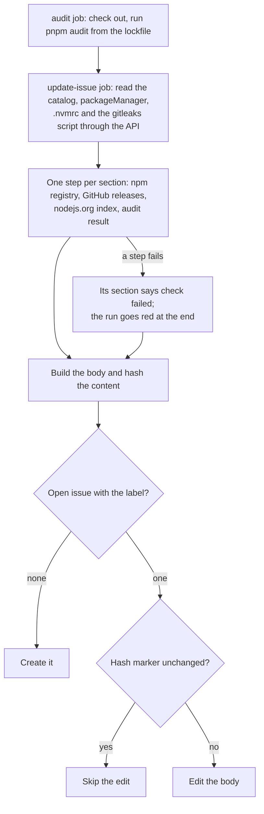

# automation

Reusable GitHub Actions workflows. Callers pin a full commit SHA of this
repo, never `@main`, so a change here never reaches a caller until it is re-pinned.

The actions these workflows use are pinned by SHA too. Dependabot proposes one grouped PR a
month for releases at least 14 days old; callers get those bumps only when they re-pin.

## `maintenance-dashboard.yml`

Keeps one issue per repo, titled **Maintenance dashboard** and labelled `maintenance-dashboard`,
that lists what is due: dependency updates for the `catalog:` in `pnpm-workspace.yaml`, pnpm
(`packageManager`), gitleaks (`GITLEAKS_VERSION` in the secrets-scan script), Node.js (`.nvmrc`)
and `pnpm audit` findings. Like pnpm's `minimumReleaseAge`, a release is listed only once it is
`min-release-age-days` old (default 14); prereleases never are. A check whose source file is
missing shows as "not applicable".

The workflow never changes code: no PRs, no commits. Doing the updates stays manual. Every run
recomputes the whole body and edits the issue only when the content changed, so the edit history
shows real changes. Editing an issue body notifies nobody; urgent security findings still arrive
through Dependabot alerts, but a Node.js security release (listed right away, without the
cooldown) only shows up here. If someone closes the issue, the next run creates a new one.

The `audit` job checks out the repo to run `pnpm audit` from the lockfile alone (no install, and
`--ignore-pnpmfile` so no repo code runs). Everything else is read through the REST API with
`GITHUB_TOKEN`. A broken check makes the run red and shows "check failed" in its section; the
other sections still render.

### How a run decides



### Setup in the calling repo

1. Add the caller below. The caller job must grant `contents: read` and `issues: write` itself.
2. After the first run, pin the issue it created so it stays at the top of the issue list.

```yaml
name: Maintenance dashboard
on:
  schedule:
    - cron: "41 5 * * *"
  workflow_dispatch:
permissions: {}
jobs:
  maintenance-dashboard:
    permissions:
      contents: read
      issues: write
    uses: valuecodes/automation/.github/workflows/maintenance-dashboard.yml@<full-commit-sha>
```

Replace `<full-commit-sha>` with a commit SHA of this repo. Do not use `@main`.

Inputs: `min-release-age-days` (number, default `14`) and `gitleaks-script` (string, default
`.github/scripts/secrets-scan.sh`; empty skips the gitleaks check).
