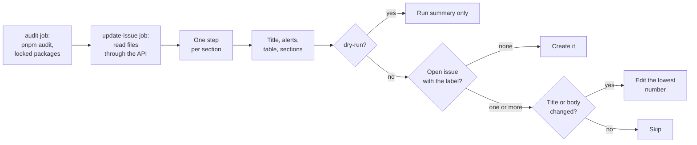
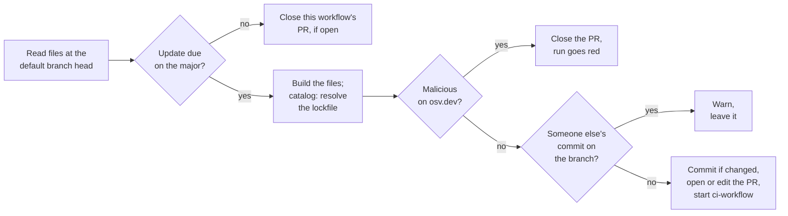

# automation

Reusable GitHub Actions workflows. Callers pin a full commit SHA of this
repo, never `@main`, so a change here never reaches a caller until it is re-pinned.

The actions these workflows use are pinned by SHA too. Dependabot proposes one grouped PR a
month for releases at least 14 days old; callers get those bumps only when they re-pin.

## `maintenance-dashboard.yml`

Keeps one issue per repo (label `maintenance-dashboard`) that lists what is due. It never
changes code; for PRs, add [`maintenance-updates.yml`](#maintenance-updatesyml) too.

| Check        | Source                                   | Shows                                                      |
| ------------ | ---------------------------------------- | ---------------------------------------------------------- |
| Security     | `pnpm audit` on the lockfile             | Advisories by severity, one row per package, path and fix  |
| Supply chain | [osv.dev](https://osv.dev), npm registry | Malicious versions; signs of a hijacked account on updates |
| Dependencies | `catalog:` in `pnpm-workspace.yaml`      | Newer versions; ⚠️ marks a new major                       |
| pnpm         | `packageManager` in `package.json`       | Newer pnpm                                                 |
| gitleaks     | `GITLEAKS_VERSION` in the secrets script | Newer gitleaks                                             |
| Node.js      | `.nvmrc`                                 | Newer release on the major, its end of life, newer LTS     |

- A release is listed once it is `min-release-age-days` old (default 14), never a prerelease.
  Node.js security releases are listed right away.
- The title names the worst state (`🔴 Security alert`, `⚠️ Node.js needs attention`,
  `⬆️ 2 updates`, `✅ all current`), so the pinned issue reads from the issue list.
- The supply chain check looks up every locked version and listed update in the OpenSSF
  [malicious-packages](https://github.com/ossf/malicious-packages) feed, which `pnpm audit`
  does not see. A hit also makes the run red, the one alert the workflow can send. The update
  signals are: provenance dropped, a new publisher, a publisher who is not a maintainer, or
  the first release in over a year.
- Each run rebuilds the body and edits the issue only when it changed. A closed issue is
  recreated. A missing source file shows "not applicable"; a broken check shows "check failed"
  and makes the run red.
- Only `GITHUB_TOKEN`: the `audit` job runs `pnpm audit` from the lockfile without installing
  or running repo code, and the files are read through the REST API.

To see the body for a repo without touching its issue, run
`scripts/dashboard-dry-run.sh owner/repo <commit> <checkout>`.

Assumptions: only the default `catalog:` is read, with a leading `^` or `~` ignored;
`@types/node` is capped at the `.nvmrc` major; the lockfile is version 6 or 9; `.nvmrc` holds an
exact version; the gitleaks script has a `GITLEAKS_VERSION="x.y.z"` line. The issue body is cut
to 60,000 characters, and the run summary has the full body.

### How a run decides



### Setup in the calling repo

1. Add the caller below. The caller job must grant `contents: read` and `issues: write` itself.
2. After the first run, pin the issue it created so it stays at the top of the issue list.

```yaml
name: Maintenance dashboard
on:
  schedule:
    - cron: "41 5 * * *"
  workflow_dispatch:
permissions: {}
jobs:
  maintenance-dashboard:
    permissions:
      contents: read
      issues: write
    uses: valuecodes/automation/.github/workflows/maintenance-dashboard.yml@<full-commit-sha>
```

Replace `<full-commit-sha>` with a commit SHA of this repo. Do not use `@main`.

Inputs:

- `min-release-age-days` (number, default `14`).
- `gitleaks-script` (string, default `.github/scripts/secrets-scan.sh`; empty skips the gitleaks
  check).
- `dry-run` (boolean, default `false`): builds the title and body and writes them to the run
  summary, but never creates the label or creates or edits the issue. Use it to try the workflow
  on a repo, or to test a change here against a real repo; this repo's CI does that on every PR.
  The caller must still grant `issues: write`, because a called workflow's job permissions are
  checked against the caller's before anything runs.

## `maintenance-updates.yml`

Keeps one PR per kind open, on the branch `maintenance-updates/<kind>`, for the updates the
dashboard lists on the current major. Each kind is its own job, so a failure names its cause.

| Kind (job) | Changes                                                                        |
| ---------- | ------------------------------------------------------------------------------ |
| `node`     | `.nvmrc`                                                                       |
| `pnpm`     | `packageManager` and its `+sha512` hash, and the pnpm pin in `pnpm-lock.yaml`  |
| `gitleaks` | `GITLEAKS_VERSION`, and `GITLEAKS_DIGEST` from ghcr.io when the script pins it |
| `catalog`  | `catalog:` entries in `pnpm-workspace.yaml`, and `pnpm-lock.yaml` to match     |

- Same rules as the dashboard: `min-release-age-days` old, no prereleases, majors stay on the
  dashboard.
- Each run updates the PRs in place, from the head of the default branch. A PR is closed when
  its update is no longer due. A PR someone closed stays closed until the update changes.
- A branch with someone else's commit is left alone, so fixes pushed to a PR are safe.
- PR titles are plain sentences (`Update Node.js to 24.23.0`); commits use
  `chore: update Node.js to 24.23.0`. The body follows the dashboard's style.
- Commits go through the API, so they are signed and no credentials touch a checkout.
- A PR changes only the files in the table, so any other mention of the exact version goes
  stale. In docs, name the major and point at the file that holds the exact version, such as
  "Node.js 24 (exact version in `.nvmrc`)". Update a pin outside the repo, such as a hosting
  build variable, by hand.

Supply chain guards:

- `catalog` runs only when the caller's `pnpm-workspace.yaml` sets `minimumReleaseAge` (at
  least `min-release-age-days` × 1440) and `trustPolicy: no-downgrade`, which hold the
  transitive versions pnpm picks to the same rules.
- The lockfile is resolved with `--lockfile-only --ignore-scripts --ignore-pnpmfile`, in a
  checkout without credentials or token: nothing is installed and no repo code runs. The pnpm
  that resolves is the one the repo already pins, never the proposed one; for a pnpm update,
  any lockfile change beyond pnpm's own entries stops the run.
- Every version an update adds is looked up on osv.dev. A malicious hit opens no PR, closes the
  open one and makes the run red.
- A package with an update signal is left out and listed in the PR. Nothing auto-merges.

CI: on a PR opened with `GITHUB_TOKEN`, `pull_request` workflows wait until someone with write
access approves them in the PR. To run CI without that click, set `ci-workflow` to a workflow
with `on: workflow_dispatch:`, and the run starts it on each pushed branch. The PR then also
shows the `pull_request` runs waiting for approval; you can leave them. Keep that CI free of
secrets, since it runs the new versions.

To see the PRs a repo would get, run `scripts/updates-dry-run.sh owner/repo [kind...]`.

### How a run decides



A dry run stops after the osv.dev check and writes the planned PR and its diff to the run
summary.

### Setup in the calling repo

1. Turn on **Allow GitHub Actions to create and approve pull requests** under Settings →
   Actions → General (in the organization's settings too, for a repo in an organization).
   Without it, opening a PR fails and the run says so.
2. Add the caller below. The caller job must grant the four permissions itself, including
   `actions: write` without `ci-workflow`: a called workflow's job permissions are fixed.
3. Give the CI workflow named in `ci-workflow` an `on: workflow_dispatch:` trigger.

```yaml
name: Maintenance updates
on:
  schedule:
    - cron: "17 6 * * 1"
  workflow_dispatch:
permissions: {}
jobs:
  maintenance-updates:
    permissions:
      contents: write # push the update branches
      pull-requests: write # open, edit and close the PRs
      actions: write # start ci-workflow on the branches
      issues: read # link the dashboard issue
    uses: valuecodes/automation/.github/workflows/maintenance-updates.yml@<full-commit-sha>
    with:
      ci-workflow: ci.yml
```

Replace `<full-commit-sha>` with a commit SHA of this repo. Do not use `@main`.

Inputs:

- `min-release-age-days` (number, default `14`).
- `gitleaks-script` (string, default `.github/scripts/secrets-scan.sh`; empty skips gitleaks).
- `ci-workflow` (string, default empty): the file name of the workflow to start on each pushed
  branch, such as `ci.yml`. Empty starts none.
- `dry-run` (boolean, default `false`): plans each PR and writes it, with the diff, to the run
  summary, but pushes nothing and opens or closes no PR. This repo's CI runs it that way against
  this repo on every PR. The caller must still grant the four permissions.

## `workflow-lint.yml`

Lints the calling repo's GitHub Actions files on every run:

- [actionlint](https://github.com/rhysd/actionlint) checks workflow syntax, `${{ }}`
  expressions, job and step references, and, through shellcheck, the bash in `run:` scripts.
  It is downloaded at an exact version and its checksum is verified.
- [zizmor](https://docs.zizmor.sh) checks for security problems: template injection, actions
  not pinned by SHA, broad permissions, persisted credentials and risky triggers.

Both tools read the caller's own `.github/actionlint.yaml` and `zizmor.yml` when present, so
per-repo tuning stays in the caller. The workflow needs no secrets and no inputs.

### Setup in the calling repo

Add the job below to the caller's CI. The caller job must grant `contents: read`. Each tool
runs as its own job, so the checks show up as `workflow-lint / actionlint` and
`workflow-lint / zizmor`. Add the caller job to the `needs` of the job you require on the base
branch; it fails when either check fails.

```yaml
jobs:
  workflow-lint:
    permissions:
      contents: read
    uses: valuecodes/automation/.github/workflows/workflow-lint.yml@<full-commit-sha>
```

Replace `<full-commit-sha>` with a commit SHA of this repo. Do not use `@main`.

## License

[MIT](LICENSE)
