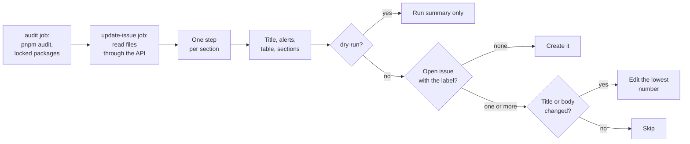
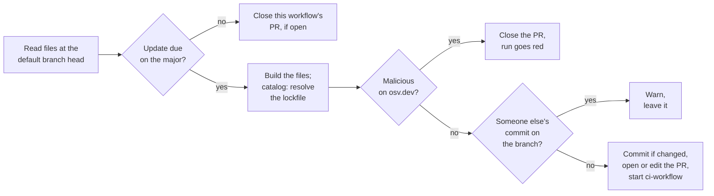

# automation

Reusable GitHub Actions workflows. Callers pin a full commit SHA of this
repo, never `@main`, so a change here never reaches a caller until it is re-pinned.

The actions these workflows use are pinned by SHA too. Dependabot proposes one grouped PR a
month for releases at least 14 days old; callers get those bumps only when they re-pin.

## `maintenance-dashboard.yml`

Keeps one issue per repo, labelled `maintenance-dashboard` and titled
`Maintenance dashboard: <state>`, that lists what is due: dependency updates for the `catalog:`
in `pnpm-workspace.yaml`, pnpm (`packageManager`), gitleaks (`GITLEAKS_VERSION` in the
secrets-scan script), Node.js (`.nvmrc`) and `pnpm audit` findings. Like pnpm's `minimumReleaseAge`, a release is listed only once it is
`min-release-age-days` old (default 14); prereleases never are. A check whose source file is
missing shows as "not applicable".

A supply chain section adds two checks that need no token. Every version in `pnpm-lock.yaml`,
plus each update the dependency table lists, is looked up on [osv.dev](https://osv.dev), which
carries the OpenSSF [malicious-packages](https://github.com/ossf/malicious-packages) feed that
`pnpm audit` does not see; git and tarball dependencies have no registry version and are only
counted. A hit is an incident, so it also makes the run red, the one notification the workflow
can send. A hit in the lockfile is an alert; a hit that is only a listed update is a warning
not to update, since that version is not installed. For each listed update the npm registry data is read for signs of a hijacked account:
provenance attestations dropped since the version in use, a different publisher, a publisher
who is not a maintainer, or the first release after more than a year. Missing provenance alone
is not reported, since most of npm has none.

Node.js updates stay on the `.nvmrc` major, so the Node.js row also gives that major's phase and
end-of-life date from the [release schedule](https://github.com/nodejs/Release), and names a newer
LTS major when there is one: "22.21.0 · in maintenance, end of life 2027-04-30 · Node.js 24 is
Active LTS".

The body opens with a summary table, one row per check with a fixed status word (✅ ok,
⬆️ update, ⚠️ attention, 🔴 alert, ⚪ n/a, ❌ failed) and the one detail that matters: a count,
a version with its release date, or a reason. pnpm, gitleaks and Node.js fit in their row and
get no section. The title carries the worst of those states and names the checks in it
(`Maintenance dashboard: 🔴 Security alert`, `⚠️ Node.js needs attention`), or the number of
checks that have updates (`⬆️ 2 updates`), so the pinned issue shows from the issue list what
needs attention. A malicious package in the lockfile titles the issue
`🔴 malicious package in lockfile`. An alert box above the table calls out malicious packages,
`pnpm audit` findings, failed checks, and a Node.js security release or end of life. The
sections with the details follow, each fact said once: the security table has one row per
package, path and fix, marks each severity (🟥 critical, 🟧 high, 🟨 moderate, ⬜ low and info)
and lists every advisory that row fixes; the dependency table marks a new major with ⚠️.

The workflow never changes code: no PRs, no commits. To get PRs for the updates on the current
major, add [`maintenance-updates.yml`](#maintenance-updatesyml) as well. Every run
recomputes the title and the whole body and edits the issue only when they changed, so the edit
history shows real changes. Editing an issue notifies nobody; urgent security findings still arrive
through Dependabot alerts, but a Node.js security release (listed right away, without the
cooldown, and flagged when any release in the range is one) only shows up here. If someone closes
the issue, the next run creates a new one.

The `audit` job checks out the repo to run `pnpm audit` from the lockfile alone (no install, and
`--ignore-pnpmfile` so no repo code runs) and to list the locked packages for the osv.dev check.
The repo files and the gitleaks releases are read through the REST API with `GITHUB_TOKEN`; the
npm registry, osv.dev, nodejs.org and the Node.js release schedule are public endpoints, called
without a token. A broken check makes the run red and shows "check failed" in its section; the
other sections still render. To see the title and body for a repo without touching its issue, run
`scripts/dashboard-dry-run.sh owner/repo <commit> <checkout>` from a clone of this repo; it exits
non-zero when a step failed. This repo's own CI runs the workflow the same way, in dry-run mode
against this repo.

What the checks assume:

- Only the default `catalog:` of `pnpm-workspace.yaml` is read; named `catalogs:` and versions
  written straight into `package.json` are not checked.
- A leading `^` or `~` in a catalog spec is ignored; any other range shows as "not an exact
  version".
- `@types/node` is only offered up to the major in `.nvmrc`.
- `pnpm-lock.yaml` must be lockfile version 6 or 9.
- `.nvmrc` must hold an exact version (`24.22.1`); `24` or `lts/*` fail the Node.js check.
- The gitleaks script must contain a line that starts with `GITLEAKS_VERSION="x.y.z"`.
- The issue body is limited to 60,000 characters: dependency rows beyond that are cut with a
  pointer to the run summary, which always has the full body.
- The label's colour and description are reset on every run.

### How a run decides



A step that fails says "check failed" in its section and the others still render. The full
body always goes to the run summary, with catalog rows cut to fit the issue. A failed check
or a malicious package makes the run red.

### Setup in the calling repo

1. Add the caller below. The caller job must grant `contents: read` and `issues: write` itself.
2. After the first run, pin the issue it created so it stays at the top of the issue list.

```yaml
name: Maintenance dashboard
on:
  schedule:
    - cron: "41 5 * * *"
  workflow_dispatch:
permissions: {}
jobs:
  maintenance-dashboard:
    permissions:
      contents: read
      issues: write
    uses: valuecodes/automation/.github/workflows/maintenance-dashboard.yml@<full-commit-sha>
```

Replace `<full-commit-sha>` with a commit SHA of this repo. Do not use `@main`.

Inputs:

- `min-release-age-days` (number, default `14`).
- `gitleaks-script` (string, default `.github/scripts/secrets-scan.sh`; empty skips the gitleaks
  check).
- `dry-run` (boolean, default `false`): builds the title and body and writes them to the run
  summary, but never creates the label or creates or edits the issue. Use it to try the workflow
  on a repo, or to test a change here against a real repo; this repo's CI does that on every PR.
  The caller must still grant `issues: write`, because a called workflow's job permissions are
  checked against the caller's before anything runs.

## `maintenance-updates.yml`

Keeps one PR per update kind open, each on its own branch `maintenance-updates/<kind>` with the
label `maintenance-updates`:

- **node**: `.nvmrc` to the newest release on its major.
- **pnpm**: `packageManager` in `package.json` to the newest pnpm on its major, with the hash
  (`+sha512.…`) replaced by the npm registry's integrity for that version when there is one.
- **gitleaks**: `GITLEAKS_VERSION` in the secrets-scan script to the newest release on its
  major, and `GITLEAKS_DIGEST`, when the script pins one, to the digest ghcr.io serves for the
  new tag.
- **catalog**: each `catalog:` entry in `pnpm-workspace.yaml` to the newest version on its
  major, and `pnpm-lock.yaml` resolved to match.

The versions follow the dashboard's rules: a release is proposed once it is
`min-release-age-days` old (Node.js security releases right away), never a prerelease, and new
majors stay on the dashboard for a person to decide. Each run recomputes every update from the
head of the default branch and updates its PR in place: a new commit when the update or the
base changed, a new title and body when they changed, nothing otherwise. When an update is no
longer due (done by hand, or its file is gone), its PR is closed and the branch deleted. A PR
someone closed without merging stays closed until the proposed update changes. A branch with a
commit this workflow did not make is never touched, so fixes pushed to a PR are safe; the run
only warns. The REST API cannot update a branch only if it is unchanged, so a push in the few
seconds between the check and the update can be lost.

The PR title is a plain sentence (`Update Node.js to 24.23.0`); the commit uses this repo's
convention (`chore: update Node.js to 24.23.0`). The body follows the dashboard: an alert box
when one is due (a Node.js security release, packages left out), a table, the release notes,
the same footer, and a link to the dashboard issue when one is open.

Commits are made through the git data API, so GitHub signs them and no credentials touch a
checkout. Only the catalog job checks out the repo, without credentials, to run
`pnpm install --lockfile-only --ignore-scripts --ignore-pnpmfile`: pnpm resolves the new lockfile
without downloading packages or running any repo code, and the step has no token.

Supply chain guards, since the PR changes what CI and then production install:

- The catalog job runs only when the caller's `pnpm-workspace.yaml` sets `minimumReleaseAge` to
  at least `min-release-age-days` × 1440 minutes and `trustPolicy: no-downgrade`. pnpm picks
  the transitive versions itself, and those two settings are what hold them to the cooldown and
  stop a release with weaker provenance than an earlier one. Without them the job shows "not
  applicable".
- Every version an update adds (the pnpm release, or each new version in the lockfile) is looked
  up on osv.dev in the OpenSSF malicious-packages feed. A hit opens no PR, closes the open one
  and makes the run red.
- An update with one of the dashboard's update signals (provenance dropped, a new publisher, a
  publisher who is not a maintainer, the first release in over a year) is left out and listed
  in the PR body.
- The PR body lists the new lockfile versions (the first 100; the run summary has all of them).
  Nothing is merged automatically.

A PR opened with `GITHUB_TOKEN` does not start the caller's `pull_request` workflows. Set
`ci-workflow` to the caller's CI file and give that workflow an `on: workflow_dispatch:`
trigger: after each push the run starts it on the PR branch, and its checks show on the PR.
Keep that CI at `contents: read` with no secrets on the path that installs and runs the code,
since it runs the new versions. Without `ci-workflow`, close and reopen the PR to run CI.

To see the PRs a repo would get without pushing anything, run
`scripts/updates-dry-run.sh owner/repo [kind...]` from a clone of this repo; it exits non-zero
when a step failed or a malicious version was found.

### How a run decides

Each kind runs as its own job (`maintenance-updates / node`, `/ pnpm`, `/ gitleaks`,
`/ catalog`), so a failure names its cause and does not hold back the others.



A dry run stops after the osv.dev check and writes the planned PR and its diff to the run
summary. The branch moves only when the update or the base changed, and the title and body are
edited only when they changed. `ci-workflow` starts only when the branch moved or the PR is new.

### Setup in the calling repo

1. Turn on **Allow GitHub Actions to create and approve pull requests** under Settings →
   Actions → General (in the organization's settings too, for a repo in an organization).
   Without it, opening a PR fails and the run says so.
2. Add the caller below. The caller job must grant the four permissions itself.
3. Give the CI workflow named in `ci-workflow` an `on: workflow_dispatch:` trigger.

```yaml
name: Maintenance updates
on:
  schedule:
    - cron: "17 6 * * 1"
  workflow_dispatch:
permissions: {}
jobs:
  maintenance-updates:
    permissions:
      contents: write # push the update branches
      pull-requests: write # open, edit and close the PRs
      actions: write # start ci-workflow on the branches
      issues: read # link the dashboard issue
    uses: valuecodes/automation/.github/workflows/maintenance-updates.yml@<full-commit-sha>
    with:
      ci-workflow: ci.yml
```

Replace `<full-commit-sha>` with a commit SHA of this repo. Do not use `@main`.

Inputs:

- `min-release-age-days` (number, default `14`).
- `gitleaks-script` (string, default `.github/scripts/secrets-scan.sh`; empty skips gitleaks).
- `ci-workflow` (string, default empty): the file name of the workflow to start on each pushed
  branch, such as `ci.yml`. Empty starts none.
- `dry-run` (boolean, default `false`): plans each PR and writes it, with the diff, to the run
  summary, but pushes nothing and opens or closes no PR. This repo's CI runs it that way against
  this repo on every PR. The caller must still grant the four permissions.

## `workflow-lint.yml`

Lints the calling repo's GitHub Actions files on every run:

- [actionlint](https://github.com/rhysd/actionlint) checks workflow syntax, `${{ }}`
  expressions, job and step references, and, through shellcheck, the bash in `run:` scripts.
  It is downloaded at an exact version and its checksum is verified.
- [zizmor](https://docs.zizmor.sh) checks for security problems: template injection, actions
  not pinned by SHA, broad permissions, persisted credentials and risky triggers.

Both tools read the caller's own `.github/actionlint.yaml` and `zizmor.yml` when present, so
per-repo tuning stays in the caller. The workflow needs no secrets and no inputs.

### Setup in the calling repo

Add the job below to the caller's CI. The caller job must grant `contents: read`. Each tool
runs as its own job, so the checks show up as `workflow-lint / actionlint` and
`workflow-lint / zizmor`. Add the caller job to the `needs` of the job you require on the base
branch; it fails when either check fails.

```yaml
jobs:
  workflow-lint:
    permissions:
      contents: read
    uses: valuecodes/automation/.github/workflows/workflow-lint.yml@<full-commit-sha>
```

Replace `<full-commit-sha>` with a commit SHA of this repo. Do not use `@main`.

## License

[MIT](LICENSE)
