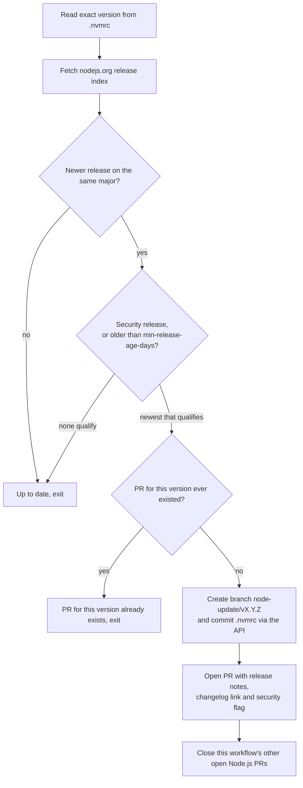

# automation

Reusable GitHub Actions workflows. Callers pin a full commit SHA of this
repo, never `@main`, so a change here never reaches a caller until it is re-pinned.

## `node-update.yml`

Keeps the exact Node.js version in `.nvmrc` current, without a bot account, a GitHub App,
secrets or third-party actions. When a newer release lands on the same major it opens one pull
request: immediately for security releases, after a configurable cooldown
(`min-release-age-days`, default 14) for the rest. Each PR links the release notes and changelog,
flags security releases, and closes the workflow's other open Node.js PRs.

It uses only `GITHUB_TOKEN` and the REST API: no extra secrets to configure, and nothing is
checked out. One branch per version (`node-update/v<version>`); a version that already had a PR,
even a closed one, is not proposed again.

### How a run decides



### Setup in the calling repo

1. Settings → Actions → General → Workflow permissions: enable **Allow GitHub Actions to create
   and approve pull requests**. Without it, `gh pr create` fails.
2. Add the caller below. The caller job must grant `contents: write` and `pull-requests: write`
   itself; a called workflow cannot raise the caller's token permissions.
3. PRs opened with `GITHUB_TOKEN` do not start CI on their own. Click **Approve workflows to run**
   on the PR. If no runs show up, close and reopen the PR.

```yaml
name: Node.js update
on:
  schedule:
    - cron: "17 5 * * *"
  workflow_dispatch:
permissions: {}
jobs:
  node-update:
    permissions:
      contents: write
      pull-requests: write
    uses: valuecodes/automation/.github/workflows/node-update.yml@<full-commit-sha>
```

Replace `<full-commit-sha>` with a commit SHA of this repo. Do not use `@main`.
