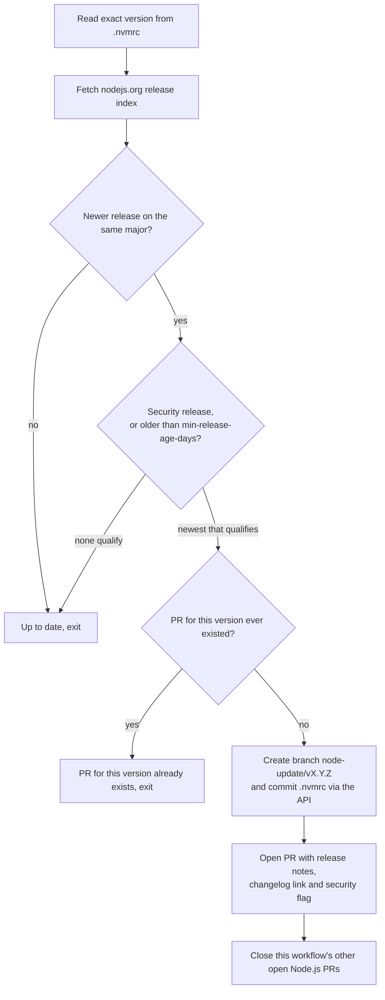

# automation

Reusable GitHub Actions workflows. Callers pin a full commit SHA of this
repo, never `@main`, so a change here never reaches a caller until it is re-pinned.

## `node-update.yml`

Keeps the exact Node.js version in `.nvmrc` current, without a bot account, a GitHub App,
secrets or third-party actions. When a newer release lands on the same major it opens one pull
request: immediately for security releases, after a configurable cooldown
(`min-release-age-days`, default 14) for the rest. Each PR links the release notes and changelog,
flags security releases, and closes the workflow's other open Node.js PRs.

It uses only `GITHUB_TOKEN` and the REST API: no extra secrets to configure, and nothing is
checked out. One branch per version (`node-update/v<version>`); a version that already had a PR,
even a closed one, is not proposed again.

### How a run decides



### Setup in the calling repo

1. Settings → Actions → General → Workflow permissions: enable **Allow GitHub Actions to create
   and approve pull requests**. Without it, `gh pr create` fails.
2. Add the caller below. The caller job must grant `contents: write` and `pull-requests: write`
   itself; a called workflow cannot raise the caller's token permissions.
3. PRs opened with `GITHUB_TOKEN` do not start CI on their own. Click **Approve workflows to run**
   on the PR. If no runs show up, close and reopen the PR.

```yaml
name: Node.js update
on:
  schedule:
    - cron: "17 5 * * *"
  workflow_dispatch:
permissions: {}
jobs:
  node-update:
    permissions:
      contents: write
      pull-requests: write
    uses: valuecodes/automation/.github/workflows/node-update.yml@<full-commit-sha>
```

Replace `<full-commit-sha>` with a commit SHA of this repo. Do not use `@main`.

## `maintenance-dashboard.yml`

Keeps one issue per repo, titled **Maintenance dashboard** and labelled `maintenance-dashboard`,
that lists what is due: dependency updates for the `catalog:` in `pnpm-workspace.yaml`, pnpm
(`packageManager`), gitleaks (`GITLEAKS_VERSION` in the secrets-scan script), Node.js (`.nvmrc`)
and `pnpm audit` findings. Like pnpm's `minimumReleaseAge`, a release is listed only once it is
`min-release-age-days` old (default 14); prereleases never are. A check whose source file is
missing shows as "not applicable".

The workflow never changes code: no PRs, no commits. Doing the updates stays manual. Every run
recomputes the whole body and edits the issue only when the content changed, so the edit history
shows real changes. Editing an issue body notifies nobody; urgent security findings still arrive
through Dependabot alerts. If someone closes the issue, the next run creates a new one.

The `audit` job checks out the repo to run `pnpm audit` from the lockfile alone (no install, and
`--ignore-pnpmfile` so no repo code runs). Everything else is read through the REST API with
`GITHUB_TOKEN`. A broken check makes the run red and shows "check failed" in its section; the
other sections still render.

### How a run decides


### Setup in the calling repo

1. Add the caller below. The caller job must grant `contents: read` and `issues: write` itself.
2. After the first run, pin the issue it created so it stays at the top of the issue list.

```yaml
name: Maintenance dashboard
on:
  schedule:
    - cron: "41 5 * * *"
  workflow_dispatch:
permissions: {}
jobs:
  maintenance-dashboard:
    permissions:
      contents: read
      issues: write
    uses: valuecodes/automation/.github/workflows/maintenance-dashboard.yml@<full-commit-sha>
```

Inputs: `min-release-age-days` (number, default `14`) and `gitleaks-script` (string, default
`.github/scripts/secrets-scan.sh`; empty skips the gitleaks check).
