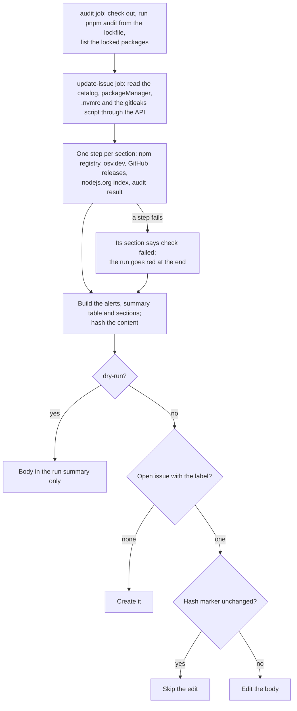

# automation

Reusable GitHub Actions workflows. Callers pin a full commit SHA of this
repo, never `@main`, so a change here never reaches a caller until it is re-pinned.

The actions these workflows use are pinned by SHA too. Dependabot proposes one grouped PR a
month for releases at least 14 days old; callers get those bumps only when they re-pin.

## `maintenance-dashboard.yml`

Keeps one issue per repo, titled **Maintenance dashboard** and labelled `maintenance-dashboard`,
that lists what is due: dependency updates for the `catalog:` in `pnpm-workspace.yaml`, pnpm
(`packageManager`), gitleaks (`GITLEAKS_VERSION` in the secrets-scan script), Node.js (`.nvmrc`)
and `pnpm audit` findings. Like pnpm's `minimumReleaseAge`, a release is listed only once it is
`min-release-age-days` old (default 14); prereleases never are. A check whose source file is
missing shows as "not applicable".

A supply chain section adds two checks that need no token. Every version in `pnpm-lock.yaml`,
plus each update the dependency table lists, is looked up on [osv.dev](https://osv.dev), which
carries the OpenSSF [malicious-packages](https://github.com/ossf/malicious-packages) feed that
`pnpm audit` does not see; git and tarball dependencies have no registry version and are only
counted. A hit is an incident, so it also makes the run red, the one notification the workflow
can send. For each listed update the npm registry data is read for signs of a hijacked account:
provenance attestations dropped since the version in use, a different publisher, a publisher
who is not a maintainer, or the first release after more than a year. Missing provenance alone
is not reported, since most of npm has none.

Node.js updates stay on the `.nvmrc` major, so the Node.js line also gives that major's phase and
end-of-life date from the [release schedule](https://github.com/nodejs/Release), and names a newer
LTS major when there is one: "Node.js 22 is in maintenance, end of life 2027-04-30; Node.js 24 is
Active LTS."

The body opens with a summary table, one row per check with its state (✅ up to date, ⬆️ update
available, ⚠️ needs attention, 🔴 vulnerabilities or malicious packages found, ⚪ not applicable,
❌ check failed). An alert box above it calls out malicious packages, `pnpm audit` findings, failed
checks, and a Node.js security release or end of life. The sections with the details follow: the security table marks each severity
(🟥 critical, 🟧 high, 🟨 moderate, ⬜ low) and the dependency table marks a new major with ⚠️.

The workflow never changes code: no PRs, no commits. Doing the updates stays manual. Every run
recomputes the whole body and edits the issue only when the content changed, so the edit history
shows real changes. Editing an issue body notifies nobody; urgent security findings still arrive
through Dependabot alerts, but a Node.js security release (listed right away, without the
cooldown, and flagged when any release in the range is one) only shows up here. If someone closes
the issue, the next run creates a new one.

The `audit` job checks out the repo to run `pnpm audit` from the lockfile alone (no install, and
`--ignore-pnpmfile` so no repo code runs) and to list the locked packages for the osv.dev check.
Everything else is read through the REST API with `GITHUB_TOKEN`. A broken check makes the run red and shows "check failed" in its section; the
other sections still render. To see the body for a repo without touching its issue, run
`scripts/dashboard-dry-run.sh owner/repo <commit> <checkout>` from a clone of this repo.

### How a run decides



### Setup in the calling repo

1. Add the caller below. The caller job must grant `contents: read` and `issues: write` itself.
2. After the first run, pin the issue it created so it stays at the top of the issue list.

```yaml
name: Maintenance dashboard
on:
  schedule:
    - cron: "41 5 * * *"
  workflow_dispatch:
permissions: {}
jobs:
  maintenance-dashboard:
    permissions:
      contents: read
      issues: write
    uses: valuecodes/automation/.github/workflows/maintenance-dashboard.yml@<full-commit-sha>
```

Replace `<full-commit-sha>` with a commit SHA of this repo. Do not use `@main`.

Inputs:

- `min-release-age-days` (number, default `14`).
- `gitleaks-script` (string, default `.github/scripts/secrets-scan.sh`; empty skips the gitleaks
  check).
- `dry-run` (boolean, default `false`): builds the body and writes it to the run summary, but
  never creates the label or creates or edits the issue. Use it to try the workflow on a repo, or to
  test a change here against a real repo. The caller must still grant `issues: write`, because a
  called workflow's job permissions are checked against the caller's before anything runs.

## `workflow-lint.yml`

Lints the calling repo's GitHub Actions files on every run:

- [actionlint](https://github.com/rhysd/actionlint) checks workflow syntax, `${{ }}`
  expressions, job and step references, and, through shellcheck, the bash in `run:` scripts.
  It is downloaded at an exact version and its checksum is verified.
- [zizmor](https://docs.zizmor.sh) checks for security problems: template injection, actions
  not pinned by SHA, broad permissions, persisted credentials and risky triggers.

Both tools read the caller's own `.github/actionlint.yaml` and `zizmor.yml` when present, so
per-repo tuning stays in the caller. The workflow needs no secrets and no inputs.

### Setup in the calling repo

Add the job below to the caller's CI. The caller job must grant `contents: read`. Each tool
runs as its own job, so the checks show up as `workflow-lint / actionlint` and
`workflow-lint / zizmor`. Add the caller job to the `needs` of the job you require on the base
branch; it fails when either check fails.

```yaml
jobs:
  workflow-lint:
    permissions:
      contents: read
    uses: valuecodes/automation/.github/workflows/workflow-lint.yml@<full-commit-sha>
```

Replace `<full-commit-sha>` with a commit SHA of this repo. Do not use `@main`.

## License

[MIT](LICENSE)
